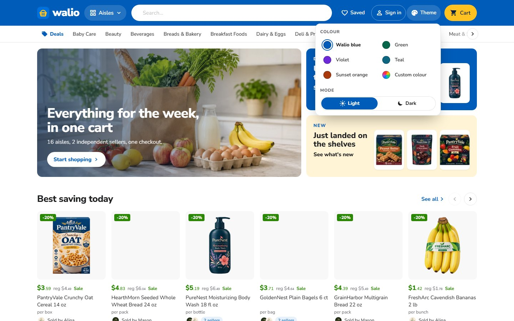
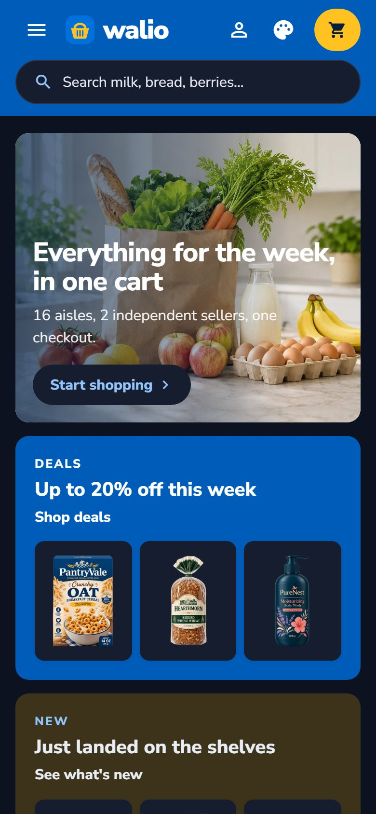
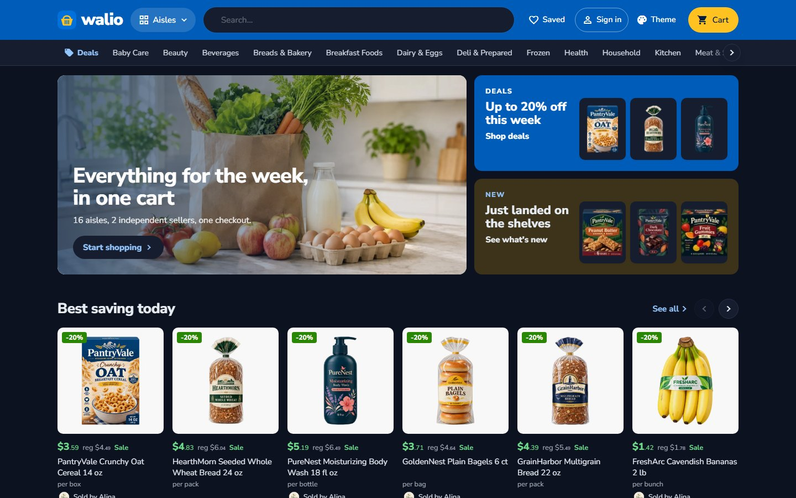

<p align="center">
  
</p>

<h1 align="center">Walio Market</h1>

<p align="center">
  <b>A blue, everyday-low-price superstore storefront for a Selldone grocery marketplace.</b><br>
  A custom Selldone Layout built on the official <a href="https://github.com/selldone/storefront">selldone/storefront</a>.
</p>

<p align="center">
  <a href="https://walio.selldone.shop"></a>
  <a href="https://github.com/selldone-custom-layouts/official-walio/wiki"></a>
  <a href="https://github.com/selldone-custom-layouts/official-walio/wiki/Install-with-AI"></a>
  
  
</p>

<p align="center">
  <a href="https://walio.selldone.shop"><b>Open the live shop</b></a> ·
  <a href="https://github.com/selldone-custom-layouts/official-walio/wiki/Install-with-AI">Set it up with AI</a> ·
  <a href="https://github.com/selldone-custom-layouts/official-walio/wiki/Manual-Setup">Manual setup</a> ·
  <a href="https://github.com/selldone-custom-layouts/official-walio/wiki/Shop-Requirements">What your shop needs</a> ·
  <a href="https://github.com/selldone-custom-layouts">All Selldone custom layouts</a>
</p>

---

## What it is

**Walio Market** dresses a grocery marketplace like an everyday-low-price superstore:
- a solid blue header with a white search and a spark-yellow basket;
- savings in green;
- rounded Nunito Sans;
- white cards on light wells;
- a checkout laid out as numbered steps.

It runs on **[walio.selldone.shop](https://walio.selldone.shop)**, one address of the Selldone shop molino. The shop's main address carries [Molino Market Hall](https://github.com/selldone-custom-layouts/official-molino), and `tario.selldone.shop` carries [Tario Market](https://github.com/selldone-custom-layouts/official-tario). Selldone lets each domain of a shop carry its own Layout.

Selldone's own basket, checkout, payments, vendor offers and orders keep working underneath. Nothing about the shop is hard-coded.

## Highlights

- **Header:** solid blue, with the shop's wordmark and a yellow round mark, an Aisles menu, a white search pill, Saved, Sign in and a **yellow Cart** that opens a small window with the cart's lines, the subtotal, the saving and View cart / Check out (a phone keeps the side drawer). Below it, a white aisle bar with blue Deals.
- **Home:** a split hero (a photo with the shop's line, a blue Deals tile with the week's best saving and a New tile), **Best saving today** (a row of equal cards, the biggest saving first), the aisles as coloured tiles, Top picks, **Shop the idea** (four breakfast products beside a photo, with Add all to cart), Pickup or delivery from the shop's own methods, Trending in the fresh aisle, and the sellers.
- **Aisle, search, Deals, All products:** a banner on the aisle's tint with its numbers and packshots, a **filter column** beside the grid (On sale only, price with quick ranges, sizes as buttons, the aisle's own filters as ticks), and Sort by; a phone gets a Filters / Sort bar. A search shows its top match first.
- **Seller pages:** a shop in the shop: the seller's card with their aisles as a menu, a blue deals banner, a row per aisle, then everything they sell.
- **Cards:** prices in heavy type (green when on offer, with the regular price), the seller, and a blue **Add to cart** that turns into "− 1 in cart +" in place; products with sizes say "Choose options".
- **Product page:** "Shop all &lt;brand&gt;", the price, the sizes, **How do you want it?** (Pickup / Delivery / Shipping with what each costs), the sellers as cards, Add to cart with the shop's free rules under it, and "About this item" in tabs.
- **Checkout:** Cart ✓ — Delivery — Contact — Review & pay over numbered steps: review your items by seller, delivery and contact (a map-first address sheet), and an order summary that leads to whatever is missing.
- **Account:** a greeting with tabs and an overview; orders as a table. **Sign-in** is a whole page.
- **Pages:** About as a magazine (How an order works), Terms and Privacy as cards and folding sections, a journal with a side column, articles with a shopping column, and a blue 404.
- **Everywhere:** no pop-ups and no phone bottom bar.

## Use it on your shop

| You want to… | Read |
| --- | --- |
| Let an AI agent (Claude Code, Codex…) set it up for your shop | [Install with AI](https://github.com/selldone-custom-layouts/official-walio/wiki/Install-with-AI) |
| Do it yourself, step by step | [Manual Setup](https://github.com/selldone-custom-layouts/official-walio/wiki/Manual-Setup) |
| Know what data your shop needs for the design to look right | [Shop Requirements](https://github.com/selldone-custom-layouts/official-walio/wiki/Shop-Requirements) |
| Build, upload and verify a release | [Build and Upload](https://github.com/selldone-custom-layouts/official-walio/wiki/Build-and-Upload) |
| Put the Layout live on your shop, or on one domain of it | [Go Live](https://github.com/selldone-custom-layouts/official-walio/wiki/Go-Live) |
| Change colours, fonts, sections or pages | [Customize](https://github.com/selldone-custom-layouts/official-walio/wiki/Customize) |
| Fix a blank page, a rejected upload or an old version showing | [Troubleshooting](https://github.com/selldone-custom-layouts/official-walio/wiki/Troubleshooting) |

The wiki's source is also in [`docs/wiki/`](docs/wiki/).

<!-- THEME:START -->
### Theme and colours

Choose Walio's colours in one file, `components/walio/walio-theme.settings.ts`:

- `palette`: blue, green, violet, teal, orange;
- or `brandColor`: any `#RRGGBB`, made readable automatically (`textOnBrand: "auto"` keeps a light brand such as yellow, with dark words);
- `mode`: light or dark;
- `themeSwitcher`: showcase, on or off.

You can also tell your AI agent "use the yellow theme" or "make it dark": `AGENTS.md` (section "Theme") tells it what to change. Then build and upload. See the wiki page [Theme and colours](https://github.com/selldone-custom-layouts/official-walio/wiki/Theme-and-colours).

The header's Theme button (palettes, Custom colour, Light / Dark) is a showcase feature. It shows only on Walio's own showcase shop (molino, Selldone shop 15645), so when you import Walio into your shop, your shoppers see Walio in its designed colours, with no Theme button. The Layout looks exactly as it does without the switcher, and any stored choice is ignored. To offer the switcher to your shoppers, set `themeSwitcher: "on"` in `components/walio/walio-theme.settings.ts`, then build and upload. `themeSwitcher: "off"` hides it everywhere.
<!-- THEME:END -->

<p> </p>



## Quick start (developers)

```bash
git clone --recurse-submodules https://github.com/selldone-custom-layouts/official-walio.git
cd official-tario
npm install --force
npm run serve            # dev server on http://localhost:9126
```

Releases: `bash scripts/release.sh <new-version> desk`. See [Build and Upload](https://github.com/selldone-custom-layouts/official-walio/wiki/Build-and-Upload).

## Where things are

| Area | Files |
| --- | --- |
| Walio's dress: the blue header, yellow basket, footer, checkout steps | [`style/walio-skin.scss`](style/walio-skin.scss) |
| Tokens: blue, green savings, Nunito Sans, corners | [`style/kalio-tokens.scss`](style/kalio-tokens.scss) |
| What Walio changed, and why | [`WALIO.md`](WALIO.md) |
| The components and every behaviour (shared with Molino) | [`components/kalio/`](components/kalio/), [`KALIO.md`](KALIO.md) |
| Release tooling | [`scripts/`](scripts/) |
| Selldone storefront's original README | [`README.selldone.md`](README.selldone.md) |

The code shares its components with [Molino Market Hall](https://github.com/selldone-custom-layouts/official-molino): the class names start with `k-` and the files with `kalio-`. The checkout steps are `t-step`; Walio's own stylesheet is `walio-skin.scss`.

## Credits and license

Built on the official [Selldone Storefront](https://github.com/selldone/storefront) (MIT License, © Selldone); see [`LICENSE.md`](LICENSE.md). Part of **[Selldone Custom Layouts](https://github.com/selldone-custom-layouts)**.
